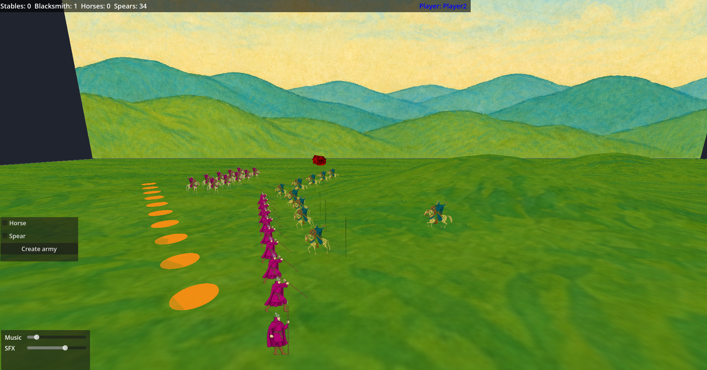

# Automated RTS — Godot 4.6

A multiplayer real-time strategy game with Total War-style formations. Command armies of spearmen, knights, bowmen and horse archers, capture stables, blacksmiths, villages and archeries to earn resources, draft new armies, and rout every enemy army to win. Supports 2–4 players and around 2000 units on a dedicated server.

## Quickstart: join a game

You need this repository, Godot 4.6.1 (downloaded by the install script), and the IP address of a running server. Only outbound UDP port **8910** is used; no port forwarding is needed on your machine.

**1. Install Godot (once).** It is downloaded into `tools/godot/`; nothing is installed system-wide.

| Windows | Linux |
|---------|-------|
| Double-click `install_godot_windows.bat` | `./install_godot_linux.sh` |

**2. Connect to the server** (use the IP the host gives you; the name is optional).

| Windows (Command Prompt) | Linux |
|--------------------------|-------|
| `connect_remote.bat SERVER_IP MyName` | `./connect_remote.sh --host=SERVER_IP --name=MyName` |

**3. In the lobby**, pick a color and press **Ready**. The match starts when every player is ready. The map is chosen in the lobby and synced from the server.

## How to play

- Each player starts with a few armies that march in from their side of the map.
- **Capture points** are taken when only your units stand near them. Each one produces a resource every 6 seconds: Stables give horses, Blacksmiths spears, Villages villagers, Archeries bows.
- **Draft** new armies from the bottom bar. Every army costs 10 villagers, plus 10 of each equipment you add. Equipment decides the unit type: horse makes knights, spear makes spearmen, bow makes bowmen, horse + bow makes horse archers, and no equipment makes clubmen.
- An army **routs** when fewer than 30 % of its soldiers are alive. The last player with an army that has not routed wins.

## Controls

| Input | Action |
|-------|--------|
| Left-click army | Select it alone (Shift+click or Shift+drag a box to add to the selection) |
| Click a portrait (bottom bar) | Add or remove that army from the selection |
| Right-click ground | Move the selected armies |
| Right-drag ground | Move and set the front line: from press (first file) to release (last file) |
| `M` / `A` / `G` | Order mode: Move / Attack / Attack-Move (or use the bottom bar) |
| Bottom bar | Stances (Aggressive, Defensive, Hold, Passive), Show range, Draft |
| `Q` / `E` or arrow keys | Rotate the selected armies |
| `W` `A` `S` `D`, middle-drag | Pan the camera |
| Mouse wheel | Zoom (the camera tilts toward the horizon as you zoom in) |
| **Menu** (top-right) | Music/SFX volume, sun lighting, animation speed |

## More documentation

- [docs/hosting.md](docs/hosting.md): run your own server, play two humans on one PC, remote debugging.
- [docs/game_design.md](docs/game_design.md): rules, unit types and the formation/combat design spec.
- [docs/maps.md](docs/maps.md): map JSON format and the map editor.
- [docs/architecture.md](docs/architecture.md): code structure, simulation and networking.
- [docs/ai_development.md](docs/ai_development.md): how the game is built and tested by an AI agent (automated tests, MockPlayer, stress tests).
- [docs/todo.md](docs/todo.md): ideas and open tasks.
