# AI-driven development

This game was built test-driven by an AI coding agent (Cursor Agent). Everything a human can do is also automatable, so the agent can start a server and two bot clients, read their logs, fix problems and repeat without a human in the loop. This file collects everything related to that workflow: the automated tests, the MockPlayer bot, stress tests, the rules agents should follow, and the AI-generated art.

## Original agent prompt

Kept verbatim. `game.md` is now [game_design.md](game_design.md); the `skills.md` commands are under "Running the tests" below and in [hosting.md](hosting.md).

I want to create a godot multiplayer game.
I want to do it test-driven with an agent building the game according to game.md
One server and two clients will then be started.
The two clients will instead of being controlled by a human player be controlled by a mock player (code) that implements a series of actions (connect to server, click Ready, select army/armies, send move commands to coordinates).
Commands will then be run to collect logs from server and the two clients (so the logs need to be saved to separate log files).
Agent will read the logs, check if there are problems, fix the problems, stop all processes, delete the logs and run everything from scratch, repeat.

skills.md is meant to list commands that can be run to start and manage the server and clients (and logs).
game.md is meant to describe the game that will be developed.
tests.json should list all things that teh mockplayers should do when running automatic gametesting ass well as otehr things that needs to be verified (e.g did the server and clinets start,did a player win and teh game end? )

## How the automated test works

A dedicated server plus two client processes are launched; the two clients are driven by a `MockPlayer` that reads a scripted test from `tests.json` and performs each action in order. Everything relevant is printed to log files with unique `TEST_*` markers, so a verifier script can assert the run succeeded.

| File | Purpose |
|------|---------|
| `game_assets/tests.json` | Single source of truth for the automated test: every event to verify, every action the MockPlayer must perform, and extra standalone headless checks. |
| `game_assets/MockPlayer.gd` | Bot client, activated by `--auto-test`. Executes the `action`s in `tests.json` for its player. |
| `run_test.sh` | Starts the server and two auto-test clients from the repo root. Logs go to `logs/`. |
| `game_assets/wait_for_test_end.sh` | Waits until `logs/server.log` contains `TEST_GAME_OVER` (env `TIMEOUT`, default 300 s). |
| `game_assets/verify_test_logs.sh` | Checks every `tests.json` marker in the logs and runs every `other_tests` command. Needs `python3`. |
| `game_assets/run_tests.sh` | Runs all headless unit tests (`test_*.gd`); `--with-logs` also runs `verify_test_logs.sh`. |
| `game_assets/run_xl_5.sh` | Runs five full XL matches back to back and reports failures. |

### Test format (`tests.json`)

```json
{
  "events": [
    {"description": "...", "marker": "TEST_XXX", "logs": ["server.log"]},
    {"description": "...", "marker": "TEST_YYY", "logs": ["client_A.log"],
     "action": {"player": "A", "type": "select_army", "army_index": 0}}
  ],
  "other_tests": [
    {"description_of_test": "...", "implementation": "<shell command>"}
  ]
}
```

- Each `events[]` entry must have a `marker` that eventually shows up in every log file listed in `logs`.
- Events with an `action` block are **executed by the MockPlayer** on the client whose `player` name matches; events without `action` are purely log-checked (they depend only on server/game behavior).
- Each `other_tests[]` entry is an arbitrary shell command; the verifier runs it and requires exit code 0.

Supported MockPlayer action types:
- `press_ready` — click the Lobby Ready button.
- `select_army` (`army_index`) — select one of the player's armies.
- `move_army_to_cp` (`army_index`, `cp_id`) — send the selected army to `Stables` or `Blacksmith`.
- `set_all_aggressive` (optional `wait_for_controls_cp`) — wait (polled) until the player controls the given CP, then flip all that player's armies to `aggressive`.

### Event sequence

```mermaid
sequenceDiagram
    autonumber
    participant Srv as Server
    participant A as ClientA
    participant B as ClientB
    Srv-->>Srv: TEST_SERVER_START
    A->>Srv: connect (TEST_CLIENT_A_START)
    B->>Srv: connect (TEST_CLIENT_B_START)
    A->>Srv: ready (TEST_A_READY)
    B->>Srv: ready (TEST_B_READY)
    Srv-->>A: world load (TEST_GAME_START)
    Srv-->>B: world load
    Srv-->>Srv: spawn 4 armies (TEST_ARMIES_SPAWNED)
    A->>A: select army 1 (TEST_A_SELECT_ARMY1)
    A->>Srv: move army 1 to Stables (TEST_A_MOVE_TO_STABLES)
    B->>B: select army 1 (TEST_B_SELECT_ARMY1)
    B->>Srv: move army 1 to Blacksmith (TEST_B_MOVE_TO_BLACKSMITH)
    Srv-->>Srv: Stables captured by A (TEST_A_CONTROLS_STABLES)
    Srv-->>Srv: Blacksmith captured by B (TEST_B_CONTROLS_BLACKSMITH)
    A->>Srv: all armies aggressive (TEST_A_AGGRESSIVE)
    B->>Srv: all armies aggressive (TEST_B_AGGRESSIVE)
    loop every 1 s while aggressive
        Srv-->>Srv: retarget each aggressive army to closest enemy
    end
    Srv-->>Srv: one player left (TEST_GAME_OVER)
```



## Running the tests

### Linux

```bash
./run_test.sh                               # server + two auto-test clients (map S)
./run_test.sh --map=XL                      # any map
./run_test.sh --map=S --dragons             # also spawn map dragons (skipped by default)
./run_test.sh --match-timeout=300           # match cap in seconds (default 120)
./game_assets/wait_for_test_end.sh          # wait for TEST_GAME_OVER
./game_assets/verify_test_logs.sh           # check every marker + run other_tests
cd game_assets && ./run_tests.sh            # headless unit tests
```

### Windows

Three Command Prompt windows in the repo root (add `--map=XL` to each for another map):

```bat
tools\godot\Godot_v4.6.1-stable_win64.exe --headless --path game_assets -- --server --auto-test
tools\godot\Godot_v4.6.1-stable_win64.exe --path game_assets -- --client --name=A --auto-test
tools\godot\Godot_v4.6.1-stable_win64.exe --path game_assets -- --client --name=B --auto-test --color=1
```

### Logs and markers

When the match ends in an auto-test run, the server quits instead of returning to the lobby (`TEST_AUTO_TEST_QUIT`) and the clients disconnect, so nothing keeps running while the checks below execute. Human matches still return to the lobby.

`./run_test.sh` writes `logs/server.log`, `logs/client_A.log` and `logs/client_B.log`. Every significant event prints a `TEST_*` marker:

```bash
grep "TEST_" logs/server.log logs/client_A.log logs/client_B.log
```

- Server: `TEST_PERF_TICK_MS avg= max= sim_avg= sim_max= sim_hz= ... tx_kbs=` every 5 s.
- Clients: `TEST_PERF_FRAME_MS ... rx_kbs=` and `TEST_SIM_CLIENT snaps= walk_in_place= tick_drift= corr= late_orders=` (hard snaps must stay 0).
- `above the MTU` warnings in `server.log` mean an unreliable RPC exceeded 1392 bytes (expected 0).

## Stress test (about 2000 units)

`./run_stress.sh` spawns extra armies so each player has N soldiers, runs the auto-test match, then prints perf from the logs and asserts server sim tick <= 25 ms at >= 19 Hz and clients >= 45 fps. Auto-test clients disable vsync so a blanked monitor cannot fake a frame-rate problem.

```bash
./run_stress.sh                                   # = --units=1000 --map=XL --seconds=90
./run_stress.sh --units=500 --map=L --seconds=60
./run_test.sh --map=XL --stress-units=1000        # same load, keep the match running
```

`--seconds` sets both how long the driver waits and the auto-test match timeout. On Windows add `--stress-units=1000 --map=XL` to the three commands above.

## Rules for AI coding agents

Before changing movement or combat code, check the spec in [game_design.md](game_design.md) first, and treat it as the behavioural contract for the game. Do not introduce behaviour that contradicts it without explicitly identifying the design trade-off. Keep player commands higher priority than autonomous reactions.

### General rules

When modifying the game:

1. **Preserve player control.** Autonomous behaviour should assist the player's order, not routinely override it.
2. **Do not make "attacked" automatically mean "stop moving."**
3. **Keep movement avoidance separate from combat targeting.**
4. **Use data/configuration for unit differences where possible.**
5. **Avoid duplicating complete AI implementations for every weapon/unit combination.**
6. **Prefer small, testable changes.**
7. **Do not change unrelated systems while implementing movement/combat behaviour.**
8. **Before changing an existing behaviour, inspect the current implementation and determine whether another system already owns that responsibility.**
9. **If a requested feature conflicts with these rules, explain the conflict and identify which rule would need to change.**
10. **Test the important combinations after movement/combat changes.**

### Formation rules

When changing the Godot implementation:

1. Treat the **formation as the primary tactical entity**.
2. Do not solve formation movement by adding stronger physics collisions.
3. Preserve the current ability for friendly units to pass through each other during formation changes unless testing shows a better mechanism is required.
4. Keep hostile formations resistant to interpenetration.
5. Prefer soft formation pressure over rigid-body pushing.
6. Implement cavalry charges as a temporary state with speed/momentum requirements.
7. Make formation depth affect resilience, pressure, and charge absorption.
8. Avoid making depth simply multiply damage.
9. Keep individual units subordinate to formation orders.
10. Do not let local combat AI permanently destroy the formation unless the game rules explicitly call for it.
11. Test formation resizing during movement and combat.
12. Test wide vs deep formations against cavalry.
13. Test shallow vs deep formations against infantry.
14. Test friendly formations moving through/reforming around one another.
15. Test whether enemy formations form stable battle lines instead of interpenetrating.

## AI-generated art

Unit sprites in `game_assets/AI_generated_sprites/<color>/<unit_type>/<action>/` (`spritesheet.png` + `spritesheet.json`, optional `sound.ogg`) were generated from reference images with Veo video generation and cut into horizontal strips. The reference images, prompts and unused intermediate sheets are kept in `source_art/` (outside the Godot project, so they are not imported). `tools/key_vegetation_png.py` removes the green screen from the vegetation images.

## Session log: scaling to 2000 units

All to-dos in the *RTS Scale To 2000 Units* plan are complete. This note records the final stretch of work and the measured end state.

### Combat stalemate

Found via the headless `test_server_match.gd`. Two small armies could sit ~20 units apart with nobody in weapon range and no anchor movement.

- Melee units on the offensive now acquire targets out to `MELEE_ACQUIRE_RADIUS` (50) and walk in.
- An idle formation with no contact closes the remaining gap instead of waiting for the target to drift 20 units.

The full multiplayer auto-test now ends with a real winner (no timeout).

### Sim performance (2000 units, profiled section by section)

- **Idle fast path:** parked units skip steering/separation on 3 of 4 ticks.
- Per-army state (`moving`, offensive, attack order) is cached in byte arrays so the unit loop does no object property reads.
- Target scan is inlined (no `query_radius` / `is_hostile` calls) plus an army-level broad phase (0.5 s round-robin) so armies with no hostile in reach skip all per-unit scans.
- Result: 2000 units marching ≈ 16 ms/tick, all idle ≈ 5 ms, dense melee ≈ 20 ms (was 24–38 ms).

### Client renderer

- Units that did not move/change are no longer rewritten each tick.
- Terrain height lookup is inlined from the height grid (no per-unit `Callable`).
- The MultiMesh buffer is uploaded only when a group changed.

### Measurement fixes

`PerfMonitor` now reports the World physics callback cost, sim step time and actual sim Hz (the engine monitor was misleading).

Auto-test clients disable vsync, because a blanked monitor made Mesa block each swap for ~1 s and report 1 fps. That was environmental, not the game.

### Stress acceptance

`./run_stress.sh --units=1000 --map=XL` (server + 2 clients on one laptop, 2040 units):

| Metric | Result |
|--------|--------|
| Server sim tick | 16.8 ms at a steady 20.0 Hz |
| Client fps | ≈ 85 |
| Upload | 33 KB/s |
| MTU warnings | 0 |
| Outcome | `STRESS_RESULT: PASS` |

### Tests and docs

- `TEST_SIM_CLIENT snaps= walk_in_place=` counters on clients (both stayed 0 through the full match) with matching `tests.json` assertions.
- NetSync pack/unpack round-trip added to `test_unit_sim.gd`.
- `run_tests.sh` and `tests.json` list the new headless tests.
- `verify_test_logs.sh` passes **42/42**.
- The documentation architecture, movement/combat, script table, map and network sections were rewritten for the new design.

### Left alone

`test_camera_w_pan_zoom_out.gd` prints a `TEST_CAMERA_W_PAN_MID_FAIL` after its `_OK` marker. It is camera-only, predates this work, and `tests.json` only checks the `_OK` marker.
